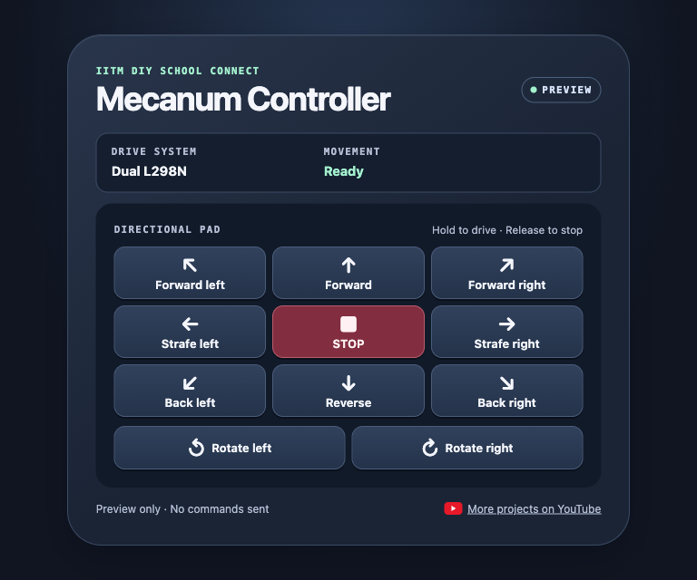
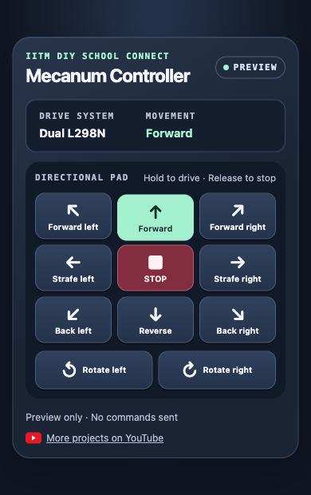

# IITM DIY School Connect ESP8266 Bot Car

Build a robot car with a NodeMCU ESP8266 and L298N motor drivers, then drive it from a phone or computer. The ESP8266 creates its own Wi-Fi network and serves the controller at [192.168.4.1](http://192.168.4.1/) after you join that network.

## Choose your build

| Build guide | L298N drivers | What it can do | Files |
| --- | --- | --- | --- |
| [Normal wheel bot](builds/normal_wheel_bot/) | 1 | Forward, reverse, turning and speed control with standard wheels | [Sketch](builds/normal_wheel_bot/normal_wheel_bot.ino) · [Wiring](builds/normal_wheel_bot/connection_diagram.jpg) · [Controller](builds/normal_wheel_bot/web_ui_preview.svg) |
| [Single-driver mecanum bot](builds/single_driver_mecanum/) | 1 | Forward, reverse, turning and speed control on a mecanum chassis | [Sketch](builds/single_driver_mecanum/single_driver_mecanum.ino) · [Wiring](builds/single_driver_mecanum/connection_diagram.jpg) · [Controller](builds/single_driver_mecanum/web_ui_preview.svg) |
| [Dual-driver mecanum bot](builds/dual_driver_mecanum/) | 2 | Forward, reverse, strafing, diagonals and rotation | [Sketch](builds/dual_driver_mecanum/dual_driver_mecanum.ino) · [Wiring](builds/dual_driver_mecanum/connection_diagram.png) · [Controller](builds/dual_driver_mecanum/web_ui_preview.svg) |

▶ [Watch the dual-driver build on YouTube](https://youtu.be/Vmh1kLvfv5M)

## New controller UI

The [new controller UI](new-ui/) uses the dual-driver mecanum wiring and adds a gamepad layout with a center Stop button, separate rotation controls, and movement feedback. Hold a direction to drive and release it to stop. You can also drive with the arrow keys.

[Download the interactive preview](new-ui/dual_driver_mecanum_ui/controller.html) and open it in a browser to try the controls without a bot. See the [new UI guide](new-ui/) to upload it to your ESP8266.

| Desktop preview | Phone preview |
| --- | --- |
|  |  |

## Set up the ESP8266

1. Install the [Arduino IDE](https://www.arduino.cc/en/software).
2. In **Preferences → Additional Boards Manager URLs**, add the [ESP8266 board package URL](https://arduino.esp8266.com/stable/package_esp8266com_index.json).
3. Install **esp8266** in Boards Manager. See the [ESP8266 installation guide](https://arduino-esp8266.readthedocs.io/en/latest/installing.html) for details.
4. Download the repository and keep each sketch in its named folder. Follow the build guide to wire the bot, select **NodeMCU 1.0 (ESP-12E Module)**, and upload the sketch.
5. Join the Wi-Fi network listed in your guide, then open the controller in your browser.

[NodeMCU ESP8266 pinout](assets/nodemcu-esp8266-pinout.png) · [Download the repository ZIP](https://github.com/NamaiBest/IITM-DIY-ESP8266/archive/refs/heads/main.zip)

## Repository layout

- [`builds/`](builds/) contains the original sketches, build guides, wiring diagrams, and controller previews.
- [`new-ui/`](new-ui/) contains the updated dual-driver sketch, interactive preview, and screenshots.
- [`assets/`](assets/) contains shared documentation images.

## More projects

