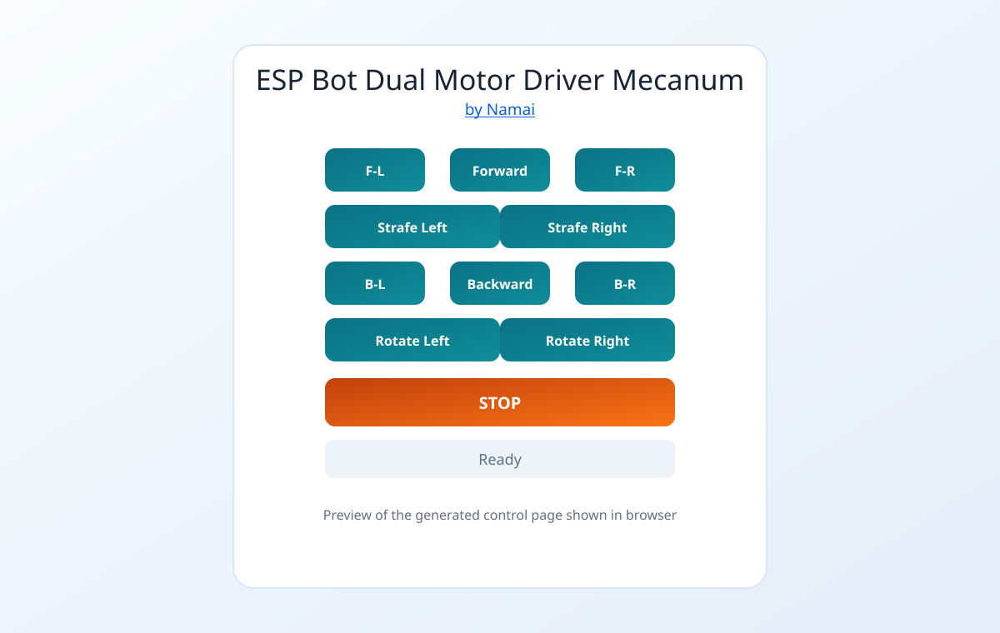
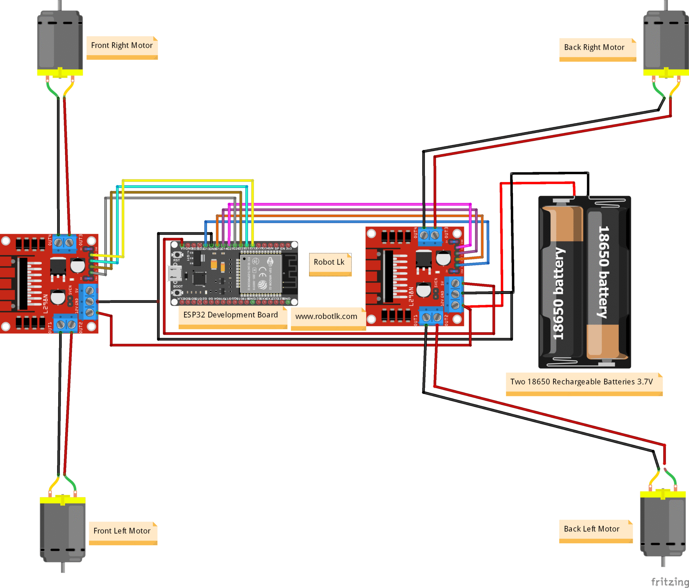

# Dual-driver mecanum bot

[All builds](../../README.md) · [NodeMCU pinout](../../assets/nodemcu-esp8266-pinout.png)

| Motor drivers | Controls |
| --- | --- |
| 2 × L298N | Forward, reverse, strafing, diagonals and rotation |

## Build video

▶ [Watch the dual-driver mecanum build on YouTube](https://youtu.be/Vmh1kLvfv5M)

## Upload and drive

1. Complete the [Arduino IDE and ESP8266 setup](../../README.md#set-up-the-esp8266).
2. Wire the bot using the [connection diagram](#connection-diagram).
3. Open [`dual_driver_mecanum.ino`](dual_driver_mecanum.ino), select **NodeMCU 1.0 (ESP-12E Module)** and the board's USB port, then upload.
4. Connect your phone or computer to **`IITM-DIY-Mecanum-2D`** with password **`12345678`**.
5. On that network, open [the bot controller](http://192.168.4.1/). Hold a direction button to drive and release it to stop.

If the controller does not load, confirm your device is still on the bot's Wi-Fi. On a phone, temporarily turn off mobile data if it keeps switching networks.

To change the network, edit `ssid` and `password` in the sketch. Use at least eight characters for the password. If you set a custom AP address with `WiFi.softAPConfig(...)`, open that address in the browser.

## Controller preview

[Try the new controller UI for this build](../../new-ui/).

## Connection diagram

## Wiring

### ESP8266 to L298N inputs
Driver 1 (Front):
- IN1 -> GPIO5 (D1)
- IN2 -> GPIO4 (D2)
- IN3 -> GPIO14 (D5)
- IN4 -> GPIO12 (D6)

Driver 2 (Back):
- IN1 -> GPIO13 (D7)
- IN2 -> GPIO16 (D0)
- IN3 -> GPIO3 (RX)
- IN4 -> GPIO1 (TX)

### Driver to Motors
First L298N (front motors):
- Front-left motor red -> OUT2
- Front-left motor black -> OUT1
- Front-right motor red -> OUT3
- Front-right motor black -> OUT4

Second L298N (back motors):
- Back-left motor red -> OUT2
- Back-left motor black -> OUT1
- Back-right motor red -> OUT3
- Back-right motor black -> OUT4

### Power and Ground
- Common GND is mandatory across ESP8266 and both L298N boards.
- Use proper battery supply for motors through each L298N motor power input.
- Keep L298N 5V and ESP8266 power wiring stable and correctly regulated.

### ESP32 reference mapping

The ESP32 mapping below is a reference. Use the ESP8266 mapping above for this build.

Driver 1 (Front):
- IN1 -> GPIO13
- IN2 -> GPIO12
- IN3 -> GPIO14
- IN4 -> GPIO27

Driver 2 (Back):
- IN1 -> GPIO26
- IN2 -> GPIO25
- IN3 -> GPIO33
- IN4 -> GPIO32

### Boot Safety Note for ESP8266
- The dual ESP8266 mapping above avoids boot-strap pins GPIO0, GPIO2, and GPIO15 to prevent boot lock issues.
- RX/TX are used as motor outputs, so do not use Serial Monitor control while motors are connected.
- You may still see a brief motor twitch at power-on due to boot serial output on TX, but this does not block boot.

## More projects

