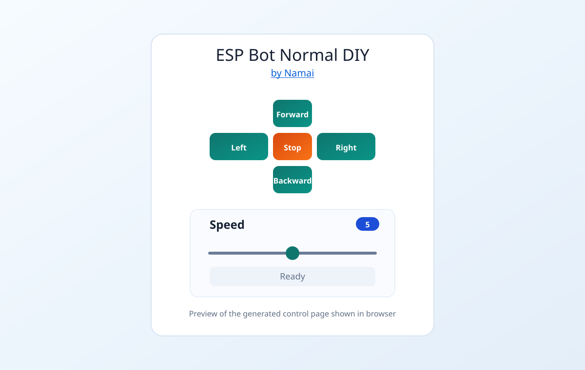
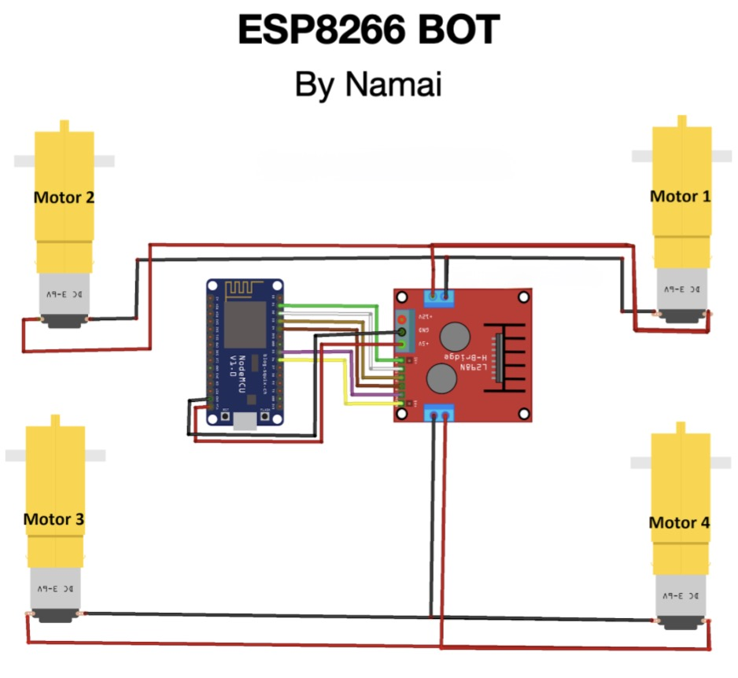

# Normal wheel bot

[All builds](../../README.md) · [NodeMCU pinout](../../assets/nodemcu-esp8266-pinout.png)

| Motor drivers | Controls |
| --- | --- |
| 1 × L298N | Forward, reverse, turning and speed control |

## Upload and drive

1. Complete the [Arduino IDE and ESP8266 setup](../../README.md#set-up-the-esp8266).
2. Wire the bot using the [connection diagram](#connection-diagram).
3. Open [`normal_wheel_bot.ino`](normal_wheel_bot.ino), select **NodeMCU 1.0 (ESP-12E Module)** and the board's USB port, then upload.
4. Connect your phone or computer to **`IITM-DIY-Normal`** with password **`12345678`**.
5. On that network, open [the bot controller](http://192.168.4.1/). Hold a direction button to drive and release it to stop.

If the controller does not load, confirm your device is still on the bot's Wi-Fi. On a phone, temporarily turn off mobile data if it keeps switching networks.

To change the network, edit `ssid` and `password` in the sketch. Use at least eight characters for the password. If you set a custom AP address with `WiFi.softAPConfig(...)`, open that address in the browser.

## Controller preview

## Connection diagram

## Wiring

### ESP8266 to L298N

- D1 (GPIO5) -> ENA
- D6 (GPIO12) -> ENB
- D2 (GPIO4) -> IN1
- D3 (GPIO0) -> IN2
- D4 (GPIO2) -> IN3
- D5 (GPIO14) -> IN4
- GND -> GND

### L298N to motors
Use one channel for left side and one channel for right side.

Left side motors (front-left and back-left in parallel):
- Red wire -> OUT2
- Black wire -> OUT1

Right side motors (front-right and back-right in parallel):
- Red wire -> OUT3
- Black wire -> OUT4

## More projects

