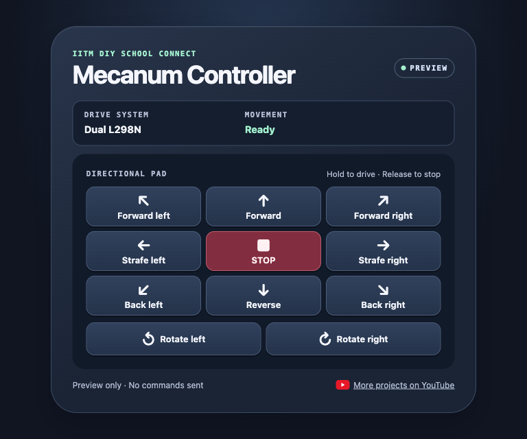
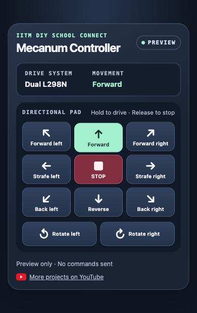

# New controller UI

This updated controller uses the same motor wiring as the [dual-driver mecanum bot](../builds/dual_driver_mecanum/). The ESP8266 serves the page directly over the bot's Wi-Fi. The interface uses plain HTML, CSS, and JavaScript.

## Try the preview

Download [controller.html](dual_driver_mecanum_ui/controller.html) and open it in a browser. Preview mode shows movement feedback locally without sending commands to a bot.

| Desktop preview | Phone preview |
| --- | --- |
|  |  |

## Upload and drive

1. Follow the [ESP8266 setup guide](../README.md#set-up-the-esp8266) and the [dual-driver wiring guide](../builds/dual_driver_mecanum/#wiring).
2. Keep the [`dual_driver_mecanum_ui` folder](dual_driver_mecanum_ui/) together and open [`dual_driver_mecanum_ui.ino`](dual_driver_mecanum_ui/dual_driver_mecanum_ui.ino) in Arduino IDE.
3. Select **NodeMCU 1.0 (ESP-12E Module)** and the board's USB port, then upload.
4. Join **`IITM-DIY-Mecanum-UI`** with password **`12345678`** and open [the bot controller](http://192.168.4.1/).
5. Hold a direction to drive and release it to stop. Use the arrow keys for forward, reverse, and strafing. Hold Space or Enter on a focused direction button for any move. Press **Esc** or **Stop** to halt.

The board stops the motors after 850 ms without a movement command. The controller refreshes the command while a direction is held.

## Edit the controller

Edit [controller.html](dual_driver_mecanum_ui/controller.html), then run `python3 embed_controller.py` from the sketch folder to regenerate the [embedded page](dual_driver_mecanum_ui/controller_page.h) before uploading again.

[All builds](../README.md) · [Dual-driver connection diagram](../builds/dual_driver_mecanum/connection_diagram.png)

